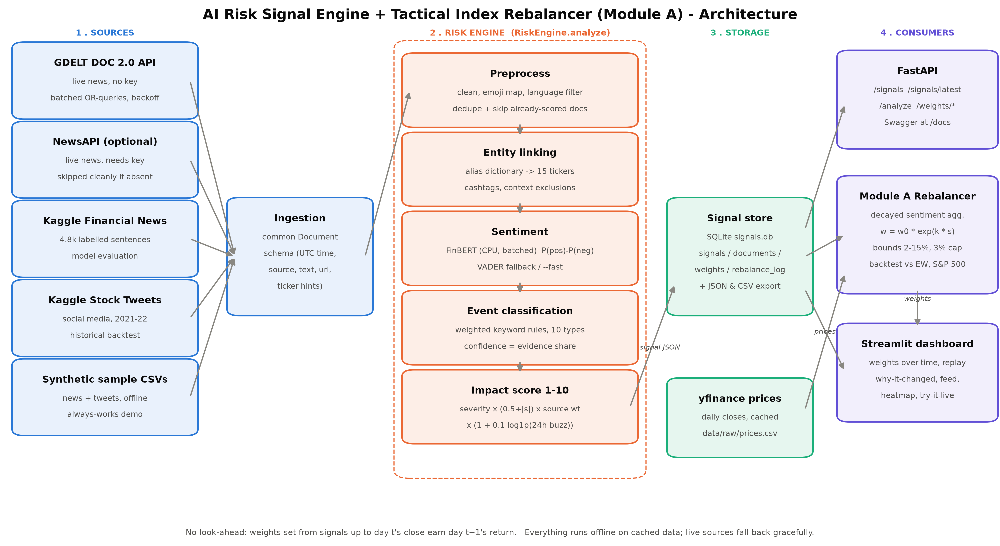
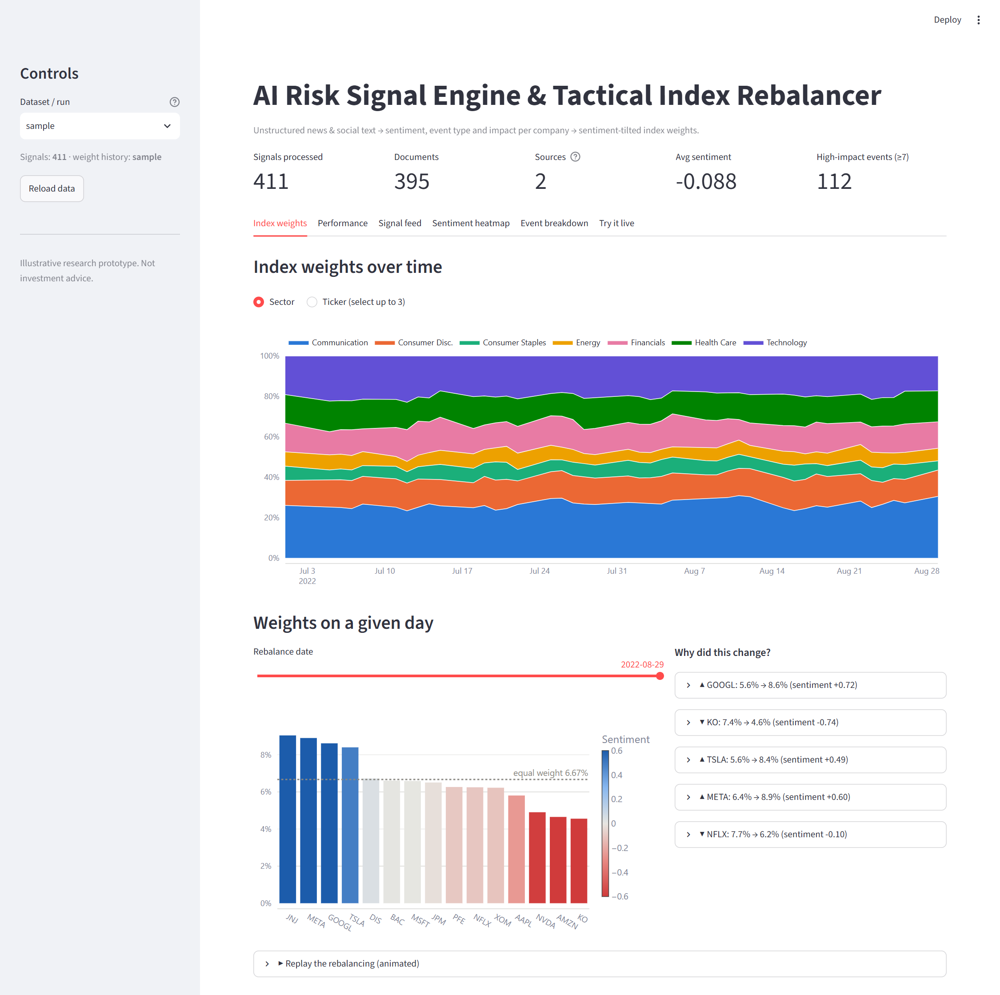
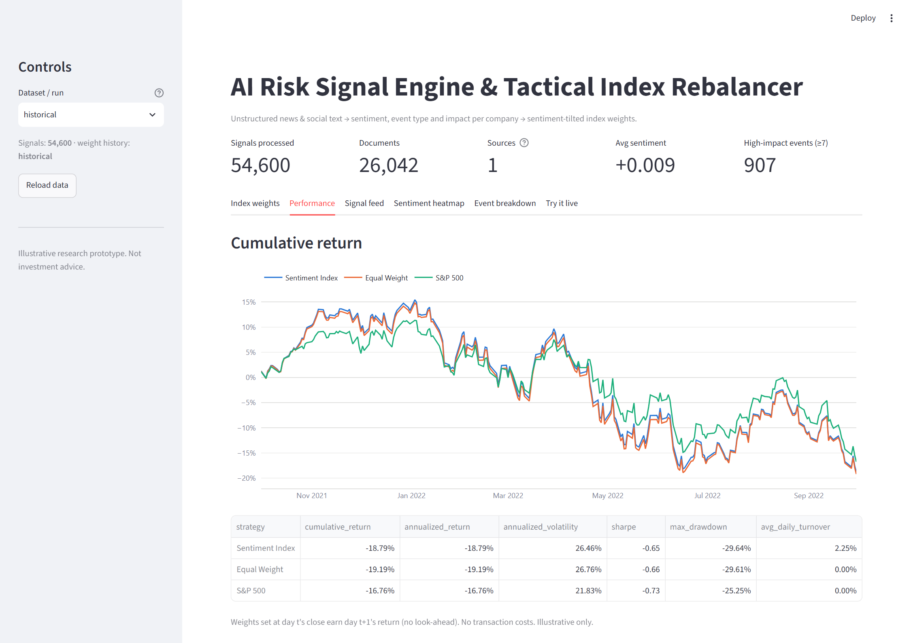
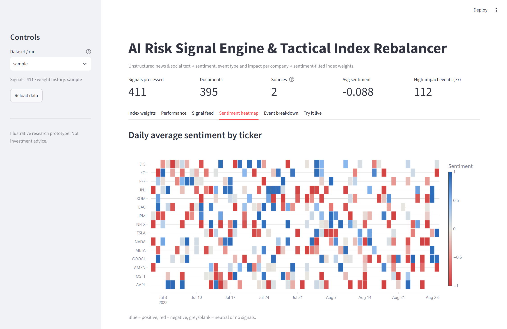
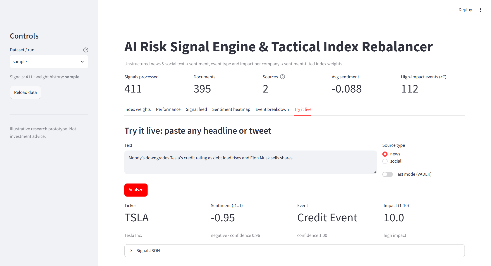

# Real-Time AI Risk Signal Engine & Tactical Index Rebalancer - S&P Global & Crisil Campus Hackathon

**Candidate Name:** Vaibhav
**College Email ID:** vaibhav24597@iiitd.ac.in
**College / Campus:** IIIT Delhi
**Demo Video Link:** _to be added (YouTube, unlisted)_
**Slide Deck Link (if hosted externally):** [docs/presentation.pdf](docs/presentation.pdf)

> Illustrative research prototype built on public and synthetic data. **Not investment advice.**

---

## 1. Project Overview / Problem Statement & Approach

Market-moving information arrives as unstructured text: news headlines, wire stories and social-media posts.
Risk and index teams cannot read all of it, and keyword alerts are noisy and hard to compare across companies.
The problem is to turn that text stream into **structured, explainable risk signals** that downstream systems
can use, and to show one concrete use for them.

**Approach.** The engine ingests text from two kinds of source (news and social media), links each item to
companies in a 15-stock S&P 100 universe, and gives every (document, company) pair three numbers:

| Output | How it is produced |
|---|---|
| **Sentiment score** (-1..1) | FinBERT (`ProsusAI/finbert`, finance-tuned BERT) on CPU: `P(positive) - P(negative)`. VADER fallback. |
| **Event classification** (10 classes) | Weighted keyword/regex rules: Geopolitical, Macroeconomic, Credit Event, M&A, Earnings, Product Launch, Regulatory/Legal, Management Change, Supply Chain/Operations, Other |
| **Impact score** (1..10) | A transparent formula: event severity x tone strength x source credibility x buzz (see below) |

**Module A - Tactical Index Rebalancer.** The signals feed a mock equal-weight index of 15 stocks. Each day the
rebalancer computes a time-decayed, impact-weighted sentiment per stock and tilts weights toward positive news
and away from negative news, inside hard limits (2%-15% per stock, at most 3 points of change per stock per day).
Every weight change is logged with the headlines that caused it, and a Streamlit dashboard replays how the index
changed over time. A daily backtest compares the sentiment index with an equal-weight index and the S&P 500.

## 2. Architecture & Tech Stack



**Data flow:** sources -> `Document` schema -> `RiskEngine.analyze()` (preprocess -> entity linking -> sentiment
-> event -> impact) -> SQLite `signals` table (+ JSON/CSV export) -> FastAPI, the Module A rebalancer and the dashboard.

| Layer | Choice | Why |
|---|---|---|
| Language | Python 3.12 | Best ML library support on Windows |
| Sentiment | FinBERT via `transformers` + `torch` (CPU build); VADER fallback | Pretrained on financial text, no training needed; VADER for `--fast` / no-torch |
| Events | Weighted regex rules (`src/engine/events.py`) | Explainable, fast, easy to audit |
| Entities | Alias dictionary + cashtags + context exclusions (`config.yaml`) | Reliable for a fixed 15-stock universe |
| Live news | GDELT DOC 2.0 API (no key); NewsAPI optional | Free real-time feed |
| Historical text | Kaggle stock tweets, Kaggle financial news | Dated social data for backtest; labelled news for evaluation |
| Prices | `yfinance`, cached to `data/raw/prices.csv` | Free; cache means the demo works offline |
| Storage | SQLite `data/signals.db` + `signals.json` / `signals.csv` | One file, easy to query and share |
| API | FastAPI + uvicorn | Typed endpoints, Swagger UI for free |
| Dashboard | Streamlit + Plotly | Interactive charts quickly |
| Tests | pytest (169 tests) | Engine and rebalancer invariants, no look-ahead |

### Signal schema (the key output)

```json
{
  "signal_id": "f57b1ffdb6c2b8c9",
  "doc_id": "fc5e73931ab722c6",
  "timestamp": "2022-08-29T14:43:00Z",
  "ticker": "PFE",
  "company": "Pfizer Inc.",
  "source": "gdelt",
  "source_type": "news",
  "sentiment_score": -0.9488,
  "sentiment_label": "negative",
  "sentiment_confidence": 0.9572,
  "event_type": "Regulatory/Legal",
  "event_confidence": 0.65,
  "impact_score": 8.7,
  "headline": "Pfizer shares slide after FDA rejects new cancer drug",
  "url": "https://..."
}
```

### Impact score formula (all weights in `config.yaml`)

```
raw    = base_severity[event_type]               # Credit 8, Geopolitical 7, M&A 7, Macro 6, Reg/Legal 6,
                                                 # Earnings 5, Mgmt 5, Supply chain 5, Product 4, Other 2
       * (0.5 + |sentiment_score|)               # stronger tone -> bigger impact
       * source_weight                           # news 1.0, social 0.7
       * (1 + 0.1 * log1p(mentions_24h))         # buzz: earlier mentions of the ticker in the last 24h
impact = clip(round(raw, 1), 1, 10)
```

### Rebalancing formula (Module A)

```
agg_sentiment_i(t) = sum_j s_j * (impact_j/10) * exp(-lambda * age_j)  /  ( sum_j (impact_j/10) * exp(-lambda * age_j) + prior )
                     lambda = ln 2 / 24h  (24-hour half-life), prior = 0.2 so no news -> decays to neutral,
                     only signals with timestamp <= t are used

target_i = (1/15) * exp(k * agg_sentiment_i)      k = 0.5
w_i      = clip(c * target_i, lower_i, upper_i)   lower_i = max(2%,  w_old_i - 3%)
                                                  upper_i = min(15%, w_old_i + 3%)
           with the scale c found by bisection so that sum(w) = 1 exactly
```

**No look-ahead:** on trading day t only signals stamped up to 16:00 New York (20:00 UTC) are used, and the
weights decided at t's close earn day t+1's close-to-close return. A unit test checks this.

### API endpoints (`uvicorn src.api.main:app --port 8000`, Swagger at `/docs`)

| Method | Path | Purpose |
|---|---|---|
| GET | `/health` | Status and signal count |
| GET | `/tickers` | Universe with sectors and aliases |
| GET | `/signals?ticker=&event_type=&since=&min_impact=&mode=&limit=` | Filtered signals |
| GET | `/signals/latest?mode=` | Decayed sentiment per ticker + top driving headline |
| POST | `/analyze` `{"text": "...", "source_type": "news"}` | Run the engine on any text (not stored) |
| GET | `/weights/history?run_id=` / `/weights/latest?run_id=` | Rebalancer output |

### Repository layout

```
run_pipeline.py      ingest -> analyze -> store       (--mode sample | historical | live)
run_backtest.py      replay + benchmark comparison    (--mode sample | historical)
run_demo.py / demo.bat   one-command demo
src/ingestion/       base.py (Document), sample.py, gdelt.py, newsapi.py, kaggle_news.py, kaggle_tweets.py
src/engine/          preprocess, entities, sentiment, events, impact, engine, store
src/rebalancer/      aggregator, rebalancer, backtest, prices
src/api/main.py      FastAPI
src/dashboard/app.py Streamlit
scripts/             sample-data generator, sentiment evaluation, architecture diagram, screenshots
data/                sample CSVs, signals.db/json/csv, backtest results, cached prices (see data/README.md)
tests/               pytest suite
docs/                architecture.png, presentation.pptx/.pdf, screenshots/
```

## 3. Dataset Used

| Source | Type | Use | Licence / link |
|---|---|---|---|
| Synthetic sample (`data/sample/`) | News (210) + tweets (210), Jul-Aug 2022 | Offline demo; always works | Generated by `scripts/make_sample_data.py`, template-based, describes no real events |
| GDELT DOC 2.0 API | Live news headlines | Live mode | https://www.gdeltproject.org/ (open) |
| Kaggle "Stock Tweets for Sentiment Analysis and Prediction" | Social media, Sep 2021 - Sep 2022 | Historical backtest | https://www.kaggle.com/datasets/equinxx/stock-tweets-for-sentiment-analysis-and-prediction |
| Kaggle "Sentiment Analysis for Financial News" | 4,846 labelled financial sentences | Sentiment model evaluation | https://www.kaggle.com/datasets/ankurzing/sentiment-analysis-for-financial-news |
| Yahoo Finance via `yfinance` | Daily adjusted closes, 15 stocks + ^GSPC | Backtest returns | Cached in `data/raw/prices.csv` |
| NewsAPI (optional) | Live news | Live mode, only with a key | https://newsapi.org |

**Assumptions:** universe fixed to 15 S&P 100 names across 7 sectors; tweets dataset's `GOOG` mapped to `GOOGL`;
a document mentioning several companies produces one signal per company with the same document-level sentiment;
historical tweets capped at 25 per ticker per day to keep CPU inference time reasonable; prices are adjusted closes;
no transaction costs. The large Kaggle CSVs are not committed (download instructions in [data/README.md](data/README.md)).

## 4. Quickstart & Installation

Runtime: **Python 3.12 on Windows 11** (CPU only, no GPU needed; ~2 GB disk for torch + model).

```bat
git clone https://github.com/vaibhavsw27/IIIT-D-Vaibhav-hackathon.git
cd IIIT-D-Vaibhav-hackathon
py -3.12 -m venv .venv
.venv\Scripts\activate
pip install -r requirements.txt

REM one command: sample pipeline -> backtest -> dashboard (http://localhost:8501)
python run_demo.py
```

Individual steps:

```bat
python run_pipeline.py                    REM score the offline sample data (FinBERT; add --fast for VADER)
python run_backtest.py                    REM rebalance + compare vs equal weight and S&P 500
streamlit run src\dashboard\app.py        REM dashboard
uvicorn src.api.main:app --port 8000      REM API, Swagger UI at http://localhost:8000/docs
python run_pipeline.py --mode live --interval 900   REM poll GDELT every 15 min (Ctrl+C to stop)
pytest                                    REM 169 tests
```

Historical run (needs the Kaggle CSVs in `data/raw/`, see [data/README.md](data/README.md)):

```bat
python run_pipeline.py --mode historical  REM ~25 tweets/ticker/day through FinBERT on CPU
python run_backtest.py --mode historical
python scripts\evaluate_sentiment.py      REM accuracy / F1 on the labelled news set
```

The first FinBERT run downloads the model (~440 MB) from Hugging Face; after that everything runs offline.
Optional: copy `.env.example` to `.env` and set `NEWSAPI_KEY` to add NewsAPI to live mode.

## 5. Key Results & Domain Impact

### What the prototype outputs

- A **structured signal per company per document** (schema above), stored in SQLite and exported to `data/signals.json` / `.csv`.
- A **daily weight path** for the 15-stock index, with a plain-English reason for each change
  (example from the sample run: _"AMZN weight cut 8.3% -> 5.3% (sentiment -0.53). Drivers: [Geopolitical, s=-0.80, impact 9.8] Amazon exposed as US-China tensions escalate over Taiwan"_).
- **Live mode** turns the last day of GDELT headlines into signals and a fresh rebalance every 15 minutes.

### Sample run (synthetic data, Jul-Aug 2022, real prices)

| Strategy | Cumulative return | Ann. volatility | Sharpe | Max drawdown | Avg daily turnover |
|---|---|---|---|---|---|
| Sentiment Index | 8.03% | 26.29% | 1.98 | -7.29% | 5.08% |
| Equal Weight | 7.80% | 26.03% | 1.95 | -7.22% | 0.00% |
| S&P 500 | 5.37% | 19.96% | 1.75 | -6.38% | 0.00% |

The sample text is synthetic and unrelated to real prices, so this run only shows that the pipeline works end
to end; it is not evidence of an edge.

<!-- PHASE8_RESULTS -->

### Dashboard

| Index weights over time + "why did this change?" | Performance vs benchmarks |
|---|---|
|  |  |
| **Sentiment heatmap** | **Try it live** |
|  |  |

### Why it matters

- **Speed:** a headline becomes a scored, company-tagged signal in well under a second on a laptop CPU, instead of an analyst reading it.
- **Explainability:** every number can be traced: FinBERT class probabilities, the matched event keywords, the impact formula and the headlines behind each weight change. That matters for risk and index governance.
- **Reusable engine:** the same signal feed (via the API) could drive watch-lists, credit early warnings, or stress-testing scenarios (e.g. a "Module B"), not just this index.
- **Controlled risk:** weight bounds, a turnover cap and decay to neutral stop the index chasing single headlines.

### Limitations

- Sentiment is per document; when a headline names two companies both get the same score (entity-level sentiment would fix this).
- Entity linking is a dictionary; ambiguous aliases ("Amazon" rainforest, "Tesla" GPUs) are handled by a short exclusion list, not a model.
- Event classes come from keyword rules, so phrasing they don't cover lands in "Other".
- FinBERT was trained on news/filings; it is weaker on slang-heavy tweets.
- Backtests ignore transaction costs and cover a single year (the tweet dataset's window); results are illustrative.
- GDELT throttles heavily (about one request per 5 seconds), so a live poll takes 2-4 minutes.

**Next steps:** fine-tune FinBERT on tweets, entity-level (aspect) sentiment, zero-shot event classifier as a second opinion, transaction-cost model, and a Module B stress-testing consumer of the API.
